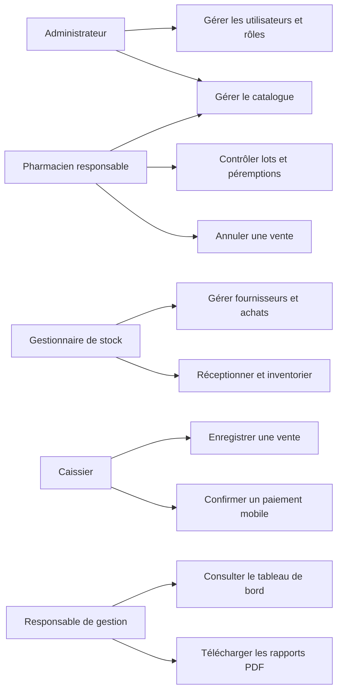
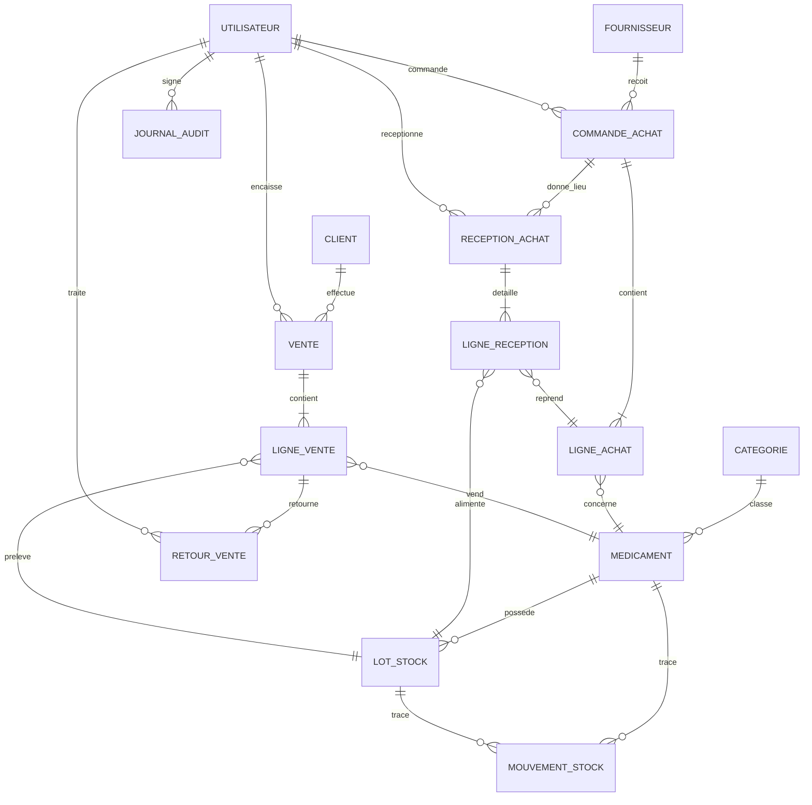
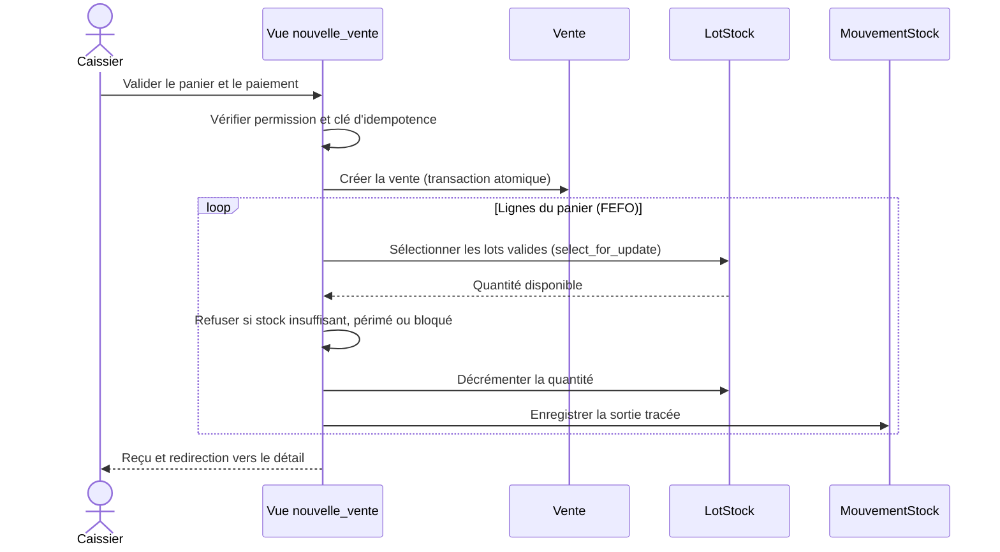
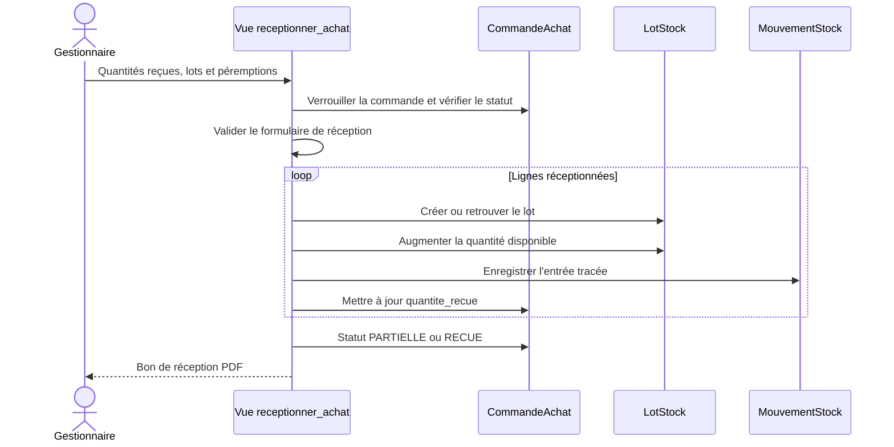
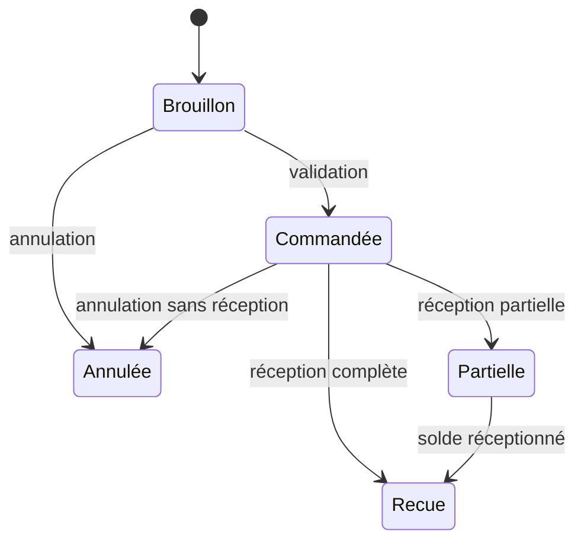

# Dossier de conception — PharmaGest

## 1. Architecture

L'application suit l'architecture MVT de Django :

- **Models** : entités, contraintes et propriétés métier (`stock_total`,
  `est_vendable`, `total`, `quantite_restante`).
- **Views** : contrôle des permissions, orchestration des transactions.
- **Templates** : gabarits partagés `shared/` et pages spécifiques.
- **URLconf** : un namespace par application (`ventes:`, `achats:`, `stock:`…).
- **Forms / Formsets** : validation serveur des saisies et des lignes.
- **Admin** : accès de secours pour l'administrateur.

Applications : `utilisateurs`, `medicaments`, `categories`, `fournisseurs`,
`clients`, `achats`, `stock`, `ventes`, `rapports`, plus `config` pour les
réglages et utilitaires transverses.

## 2. Acteurs et cas d'utilisation

| Acteur | Responsabilités |
| --- | --- |
| Administrateur | Comptes, rôles, paramètres, accès complet |
| Pharmacien responsable | Médicaments, lots, achats, ventes, annulations |
| Gestionnaire de stock | Fournisseurs, commandes, réceptions, inventaire |
| Caissier | Ventes, paiements, reçus |
| Responsable de gestion | Statistiques, rapports et consultation |

## 3. Modèle conceptuel de données (MCD)

Règles structurelles :

- un médicament appartient à une catégorie et peut avoir plusieurs lots ;
- un lot est unique par couple `(médicament, numéro de lot)` ;
- une ligne de vente référence le lot réellement délivré et fige son prix ;
- une réception référence les lignes de commande et les lots créés ;
- les opérations validées ne sont jamais supprimées silencieusement.

## 4. Modèle logique de données (MLD)

| Table | Clé primaire | Clés étrangères | Champs principaux |
| --- | --- | --- | --- |
| `categories_categorie` | `id` | — | nom (unique), description, status |
| `medicaments_medicament` | `id` | categorie_id | nom, dosage, forme, code_barre (unique), prix_achat, prix_vente, seuil, status, photo |
| `fournisseurs_fournisseur` | `id` | — | nom, adresse, telephone, mail, num_fiscal, contact_principal, status |
| `clients_client` | `id` | — | nom, telephone, email, status |
| `stock_lotstock` | `id` | medicament_id | numero_lot, date_peremption, quantite_disponible, bloque |
| `stock_mouvementstock` | `id` | medicament_id, lot_id, auteur_id | type, quantite, reference, motif, cree_le |
| `achats_commandeachat` | `id` | fournisseur_id, cree_par_id | reference (unique), statut, cree_le |
| `achats_ligneachat` | `id` | commande_id, medicament_id | quantite_commandee, quantite_recue, prix_unitaire |
| `achats_receptionachat` | `id` | commande_id, recue_par_id | reference (unique), recue_le |
| `achats_lignereception` | `id` | reception_id, ligne_achat_id, lot_id | quantite |
| `ventes_vente` | `id` | client_id, effectuee_par_id, annulee_par_id | reference (unique), cle_idempotence (unique), mode_paiement, paiement_confirme, annulee, motif_annulation |
| `ventes_lignevente` | `id` | vente_id, medicament_id, lot_id | quantite, prix_unitaire |
| `ventes_retourvente` | `id` | ligne_vente_id, effectuee_par_id | quantite, motif, remettre_en_stock, montant_remboursement, remboursement_confirme |
| `utilisateurs_journalaudit` | `id` | auteur_id | action, objet, objet_id, details, cree_le |

Les utilisateurs et groupes reposent sur `auth_user`, `auth_group` et
`auth_permission`.

## 5. Diagrammes UML

### 5.1 Séquence — vente en caisse

### 5.2 Séquence — réception d'achat

### 5.3 États d'une commande d'achat

## 6. Règles de gestion et implémentation

| Règle | Mise en œuvre |
| --- | --- |
| RG01 Identifiant unique | Clé primaire automatique Django |
| RG02 Code-barres unique | `unique=True` + validation insensible à la casse |
| RG03 Validation serveur | Formulaires, validateurs `MinValueValidator`, contrôles de vues |
| RG04 Commande sans effet stock | Aucun mouvement créé avant réception |
| RG05 Réception unique | Statut vérifié et verrouillage `select_for_update` |
| RG06 Vente unique | Clé d'idempotence + `transaction.atomic` |
| RG07 Stock non négatif | Contrôle de disponibilité et refus des ajustements négatifs |
| RG08 Lots exclus de la vente | Filtre `bloque=False`, `date_peremption > aujourd'hui` |
| RG09 Traçabilité | `JournalAudit` + `MouvementStock` avec auteur et date |
| RG10 Pas de suppression silencieuse | Annulation et retours compensatoires |
| RG11 Accès restreint | `@permission_required` et rôles Django |
| RG12 Prix historiques | `prix_unitaire` figé sur `LigneVente` et `LigneAchat` |

## 7. Choix techniques

- **FEFO** : les lots sont triés par `date_peremption` croissante lors de la
  vente ; un lot périmé, bloqué ou vide est ignoré.
- **Transactions atomiques** : ventes, réceptions, annulations et retours sont
  exécutés dans `transaction.atomic()` avec verrouillage des lignes.
- **PDF** : ReportLab génère reçus, factures, bons et rapports à la demande.
- **Sécurité** : CSRF, permissions par vue, validation des images, secrets en
  variables d'environnement, HTTPS et cookies sécurisés en production.
- **Sauvegarde** : copie cohérente via l'API de sauvegarde SQLite.
